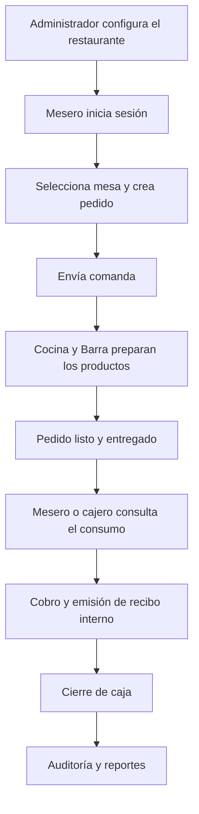
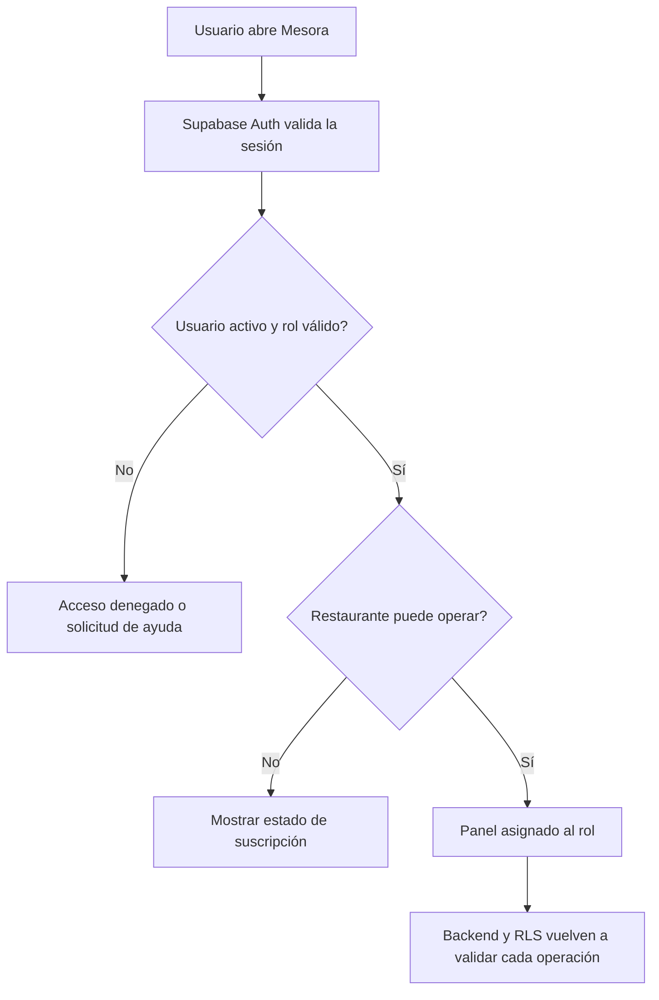
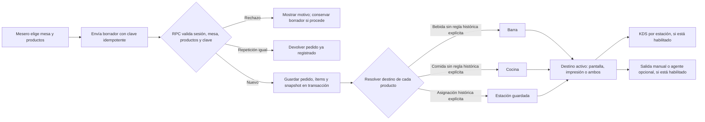
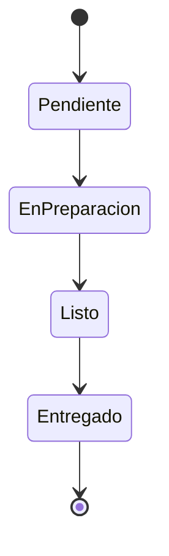
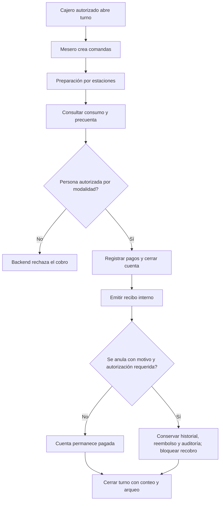
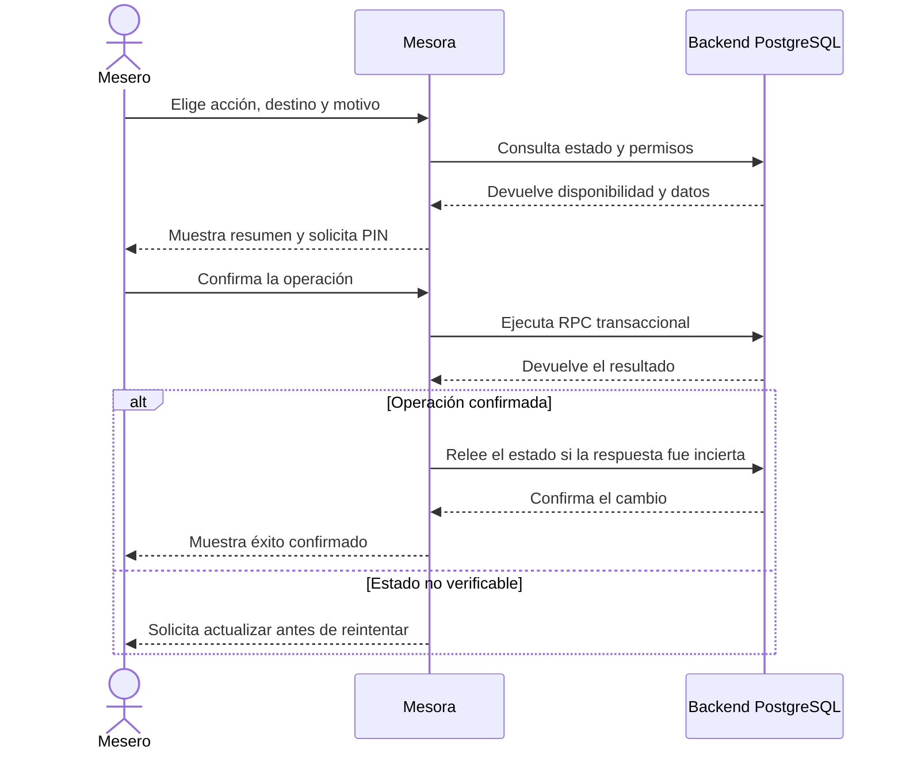
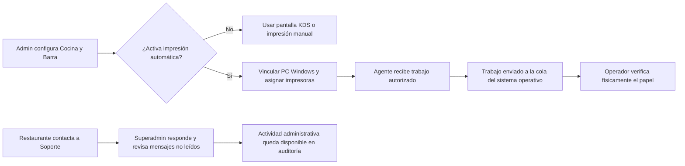

# Flujos del sistema — Mesora 1.0

## 0. Flujo general de Mesora

Mesora conecta la toma de pedidos, la preparación en Cocina y Barra, el cobro, el cierre de caja y el análisis administrativo en un solo flujo. Las acciones sensibles quedan registradas en auditoría.

## 1. Inicio de sesión y autorización

## 2. Pedido y enrutamiento a estaciones

La misma clave de una comanda se conserva en reintentos; una nueva comanda legítima para esa mesa usa otra clave. Los cambios de configuración no reescriben snapshots históricos.

## 3. Preparación

El estado se consulta dentro de la estación correspondiente. Cocina no debe modificar el estado de Barra. Pedidos cobrados o anulados no vuelven a la cola activa; las salidas canceladas por anulación permanecen en el historial, bloqueadas para impresión.

## 4. Caja, cobro y recibo interno

La precuenta es una vista previa. No registra pago, recibo ni cierre de mesa.

## 5. Traslado y cambio de responsable

## 6. Impresión y soporte

El estado “enviado a la cola” no certifica que el papel haya salido. El respaldo automático KDS a impresora permanece desactivado.
